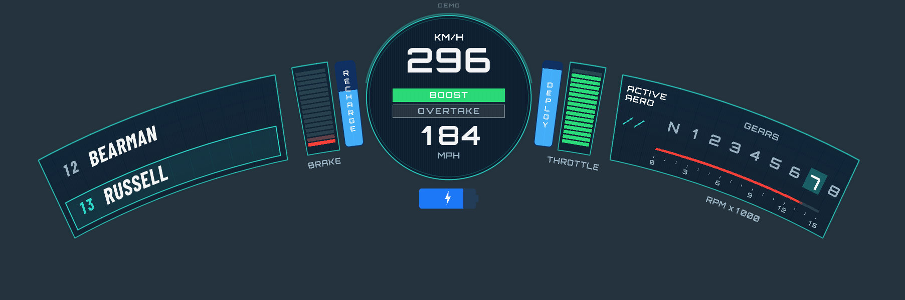

# HaloHUD for Assetto Corsa

**Version 1.7.0 · Assetto Corsa + CSP · MIT**

An unofficial, F1-inspired onboard telemetry overlay for Assetto Corsa. It draws a curved teal-and-navy HUD around the cockpit view using a CSP Lua app and original artwork.



## Features

- Live speed in km/h and mph, gear, RPM, brake, throttle, battery charge, deploy and recovery gauges.
- A two-row timing panel with race-position tracking, a leader/second-place layout and a centered solo-player state.
- Animated Active Aero driven by DRS telemetry, plus configurable fallbacks for cars without KERS.
- Mouse positioning, live scale/curvature controls, independent panel sizes, themes and an optional outer arc.
- Automatic settings persistence and visibility that follows **Ctrl+H**.
- Synthetic demo telemetry, browser previews and reproducible texture generation with bundled OFL fonts.

## Getting started

### Requirements

To drive, use Windows, the original **Assetto Corsa**, **Content Manager** and **Custom Shaders Patch 0.2.0 or newer** (build 2651 minimum). Python, Node.js and system-installed fonts are not required to run the app.

The HUD targets a single screen. It uses screen-space projection: it has no true halo attachment, depth occlusion or camera parallax. Camera examples need car-specific calibration.

### Install or upgrade

1. Close Assetto Corsa and back up any existing `apps/lua/HaloHUD/config.ini`.
2. Copy this project's [apps](apps/) folder into the Assetto Corsa installation root. The resulting path must be `assettocorsa/apps/lua/HaloHUD/manifest.ini`.
3. When upgrading, replace the Lua files **and** assets, then restore your saved `config.ini`. Missing settings receive defaults.
4. Enable Lua apps in Content Manager if needed, start a session and open **HaloHUD controls** from the app sidebar.

An install ZIP can also be dropped into Content Manager if its installer recognizes it; otherwise use the manual steps above. Do not install `docs`, `source`, `tests` or previews into the game. The app does not edit car files.

### Position and configure the HUD

Enable **Drag HUD with mouse**, then left-drag the handle above the dial. Turn the option off when finished. Overall scale, X/Y offsets, curvature and independent panel scales also update immediately from the controls window.

Edits auto-save to [config.ini](apps/lua/HaloHUD/config.ini) after 0.4 seconds without changes. **Save config.ini** writes immediately; **Reset to defaults** restores and saves defaults; **Reload config.ini** reads external edits.

For example, edit these keys in the existing `[HUD]` section, then reload:

```ini
[HUD]
UNITS = MPH
THEME = ICE
SCALE = 0.90
OUTER_ARC = 1
```

Both speed units remain visible; `UNITS` selects the upper readout. See the [user guide](docs/USER-GUIDE.md) for all settings, gauge formulas and fallback behavior.

### Try demo mode

In a session, enable **Force demo telemetry** to animate the gauges without driving. Turn it off to restore automatic live/no-car selection. You can also open [the standalone browser demo](previews/Demo.html) directly; it needs no local web server.

## Development

### Set up the tools

Use **Python 3.10+** and **Node.js**. Node is used by the HTML/Lua animation parity test. Python dependencies are Pillow, Lupa and NumPy; their supported ranges are in [requirements.txt](source/requirements.txt).

Run these commands from the folder containing this README:

```powershell
python -m venv ../halohud-venv
..\halohud-venv\Scripts\python.exe -m pip install -r source/requirements.txt
..\halohud-venv\Scripts\python.exe -m unittest discover -s tests -v
```

The test harness executes Lua 5.1 through Lupa and mocks CSP interfaces. The current suite has 52 tests; it does not prove native mouse routing, engine integration or GPU performance.

### Generate assets, previews and packages

The virtual environment is kept outside the project so it is excluded from release packages. Using the same environment:

```powershell
..\halohud-venv\Scripts\python.exe source/build_assets.py
..\halohud-venv\Scripts\python.exe source/render_preview.py --html
..\halohud-venv\Scripts\python.exe source/render_states.py
..\halohud-venv\Scripts\python.exe source/render_aero_motion.py
..\halohud-venv\Scripts\python.exe source/verify_layout.py
..\halohud-venv\Scripts\python.exe source/build_package.py
```

Asset generation refreshes PNGs and glyph metadata. The package builder refreshes the source listing and SHA-256 inventory, verifies ZIP CRCs and asset dimensions, and writes install/complete ZIPs beside this project folder.

If you have CSP's generated SDK, verify declarations separately:

```powershell
..\halohud-venv\Scripts\python.exe tests/verify_sdk.py "C:/path/to/assettocorsa/extension/internal/lua-sdk/ac_apps/lib.lua"
```

### Project layout

| Path | Purpose |
|---|---|
| [apps/lua/HaloHUD/](apps/lua/HaloHUD/) | Runtime Lua modules, manifest, configuration, generated textures and licenses. |
| [source/](source/) | Asset generators, renderers, inspection tools, package builder and source fonts. |
| [tests/](tests/) | Lua harness, regression tests and SDK declaration verifier. |
| [docs/](docs/) | Usage reference, API verification, car-profile notes and test checklist. |
| [previews/](previews/) | Rendered images, browser demos and approved visual references. |
| [camera/](camera/) | Separate example configurations; not installed automatically. |
| [reports/](reports/) | Recorded car/model inspections and highlight measurements. |

Start with `HaloHUD.lua` for CSP callbacks and controls, `telemetry.lua` for sampling and fallbacks, `settings.lua` for defaults/persistence, `renderer.lua` for layout and drawing, and `aero.lua` for animation. These modules live in `apps/lua/HaloHUD/`.

## Documentation and help

- [User guide](docs/USER-GUIDE.md): configuration, telemetry formulas, limitations and release history.
- [Testing checklist](docs/TESTING.md): offline commands and required in-game checks.
- [CSP API verification](docs/API-VERIFICATION.md): checked APIs and SDK baseline.
- [Formula Ultra 2026 profile](docs/CAR-PROFILE.md): verified sources, unknown values and exports needed for calibration.
- [Validation record](docs/VALIDATION.txt): completed checks and remaining in-game work.

For help, share a reproducible report with the person or repository that supplied your copy. Include the app/CSP versions, car ID, session type, resolution/UI scale, relevant config, expected/actual behavior and a screenshot or error text. No project support URL or named support contact is configured in this workspace.

The Formula Ultra profile uses available live powertrain data for the exact car ID. Packed physics, battery calibration and a working car-specific camera remain unverified. The 0.3 ms frame-time target also requires in-game measurement; it is not an offline guarantee.

## Changelog

Entries follow the development history. Dates are omitted where a release date was not recorded. The app manifest remains at 1.7.0; later documentation and publishing changes are listed separately.

### Unreleased — documentation and publication preparation

- Renamed the public-facing project to **HaloHUD for Assetto Corsa**, with an unofficial-project description and affiliation disclaimer.
- Organized the release into app, documentation, camera, source, test, preview and report folders.
- Reworked the README and added a contribution guide, preserving detailed configuration and history in the user guide.
- Removed a personal installation path and Python cache files. Added Git ignore rules and package exclusions for local files, credentials and Git metadata.

### 1.7.0 — mouse positioning

- Added **Drag HUD with mouse** and a small draggable handle above the dial.
- Connected mouse movement to the existing X/Y offsets and automatic config saving, using the actual fitted HUD scale.
- Kept movement within screen margins and retained immediate movement when reversing at an edge.
- Kept the fullscreen overlay click-through; Ctrl+H also hides the edit handle. Reset exits edit mode.
- Expanded the offline regression suite to 52 tests.

### 1.6.0 — brakes, battery and race-leader layout

- Changed brake bars to red.
- Restored a recognizable battery silhouette with a terminal nub, blue charge fill and lightning icon, without an outer border.
- In races, placed the player above second place when leading; retained the driver ahead above the player in other positions.
- Removed CLEAR TRACK from the race-leader layout and used UNAVAILABLE when opponent data is missing.

### 1.5.2 — reverse gear

- Replaced N with a highlighted R in the first gear slot while reversing; restored N in neutral and forward gears.

### 1.5.1 — global HUD visibility

- Made the overlay follow Ctrl+H and CSP global UI visibility without changing its saved enabled state.
- Kept telemetry updates and pending settings saves running while hidden.

### 1.5.0 — Active Aero animation

- Integrated the reviewed HTML animation into Lua: both slashes rotate clockwise into the active dashes and counterclockwise when deactivating, without crossing.
- Preserved smooth reversals and animation state through layout rebuilds.
- Added a configurable, automatically saved animation-duration slider.

### 1.4.1 — revised RPM threshold and inactive labels

- Changed the RPM bar's red threshold to strictly above **11,000 RPM**.
- Added separate grey boxes around inactive BOOST and OVERTAKE labels.
- Developed and reviewed the Active Aero HTML motion preview before its Lua integration.

### 1.4.0 — boost styling and automatic saving

- Removed TURN and changed OVERTAKE to plain styling.
- Highlighted BOOST in green when the displayed DEPLOY gauge exceeds 50%.
- Added automatic config saving after 0.4 seconds without edits, immediate Save, release-time flushing and failed-save retries.
- Initially used a 10,000 RPM red threshold, superseded by 1.4.1.

### 1.3.1 — AI race positions

- Used each car's live race position instead of leaderboard-array order in races, fixing the player incorrectly appearing first against bots.
- Selected the comparison driver by race position and handled missing ranks and opponents.

### 1.3.0 — readouts and solo sessions

- Removed leading zeros from both speed readouts.
- Increased brake and throttle columns to 16 segments.
- Changed the inactive Active Aero symbol to two side-by-side slashes.
- Centered the player row in solo sessions and removed its CLEAR TRACK row.

### 1.2.0 — panel geometry and car profile

- Matched the player-row highlight and text to the timing panel's curved projection and skew.
- Made RECHARGE and DEPLOY continuous blue fill gauges with damping, charging-rate calculation and configurable fallbacks.
- Removed the sponsor tag and rebalanced the right panel.
- Added the exact-ID Formula Ultra 2026 profile, inspection reports and separate camera guidance. Packed car data remained untouched; unavailable calibration values stayed unknown.

### 1.1.0 — live layout controls

- Added live overall scale, X/Y offsets, curvature and independent region scales, with Save and Reset controls.
- Added energy-gauge recovery calibration and fallback settings.
- Centered digit glyphs to correct spacing around 1, moved and reduced the DEMO label, and added the optional outer arc.

### 1.0.0 — initial overlay

- Established the curved teal-and-navy Lua HUD with timing, speed, gears, RPM, pedals, battery and aero indicators.
- Added synthetic demo telemetry, original generated artwork, installation instructions and offline validation tools.

## Maintainers and contributing

The license credits **HaloHUD contributors**. This workspace does not designate an individual maintainer or a public issue tracker.

Contributions to telemetry handling, layouts, verified car profiles, documentation and tests are welcome. Read [CONTRIBUTING.md](docs/CONTRIBUTING.md) before preparing a patch or pull request. Keep changes focused, verify CSP API names and include relevant offline/in-game evidence.

## License

Original code and artwork are covered by the [MIT license](LICENSE.txt). Bundled fonts retain their separate [Orbitron OFL](source/fonts/Orbitron-OFL.txt) and [Barlow Condensed OFL](source/fonts/BarlowCondensed-OFL.txt) licenses.

## Affiliation

HaloHUD for Assetto Corsa is an independent fan project. It is not affiliated with, endorsed by, or sponsored by Formula 1, the Formula 1 companies, Kunos Simulazioni, or the Custom Shaders Patch developers. All trademarks belong to their respective owners.
