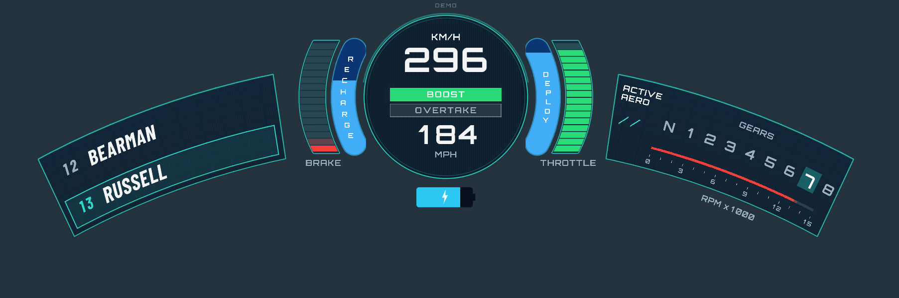
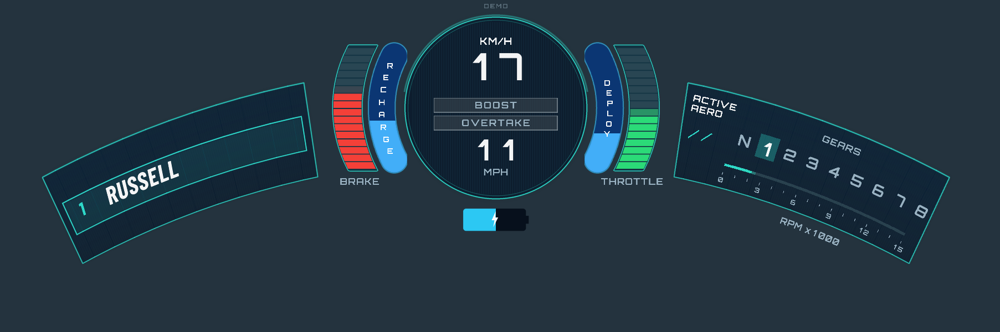

# HaloHUD for Assetto Corsa reference and release history

Curved Lua HUD for original Assetto Corsa with Content Manager and **CSP 0.2.0+ / build 2651**. The user confirmed the previous version works in AC. This revision has offline verification; the new rendering and profile behavior still need an in-game check.



## Version 1.7: reposition with the mouse

Open **HaloHUD controls**, enable **Drag HUD with mouse**, then hold the left mouse button on the **Drag HUD** handle above the center dial and move it. You can close the controls window while dragging. Turn the option off when finished. The edit mode starts off on each app launch and Reset exits it.

Dragging updates the same X_OFFSET/Y_OFFSET values as the sliders and auto-saves to config.ini after 0.4 seconds without movement. Save still writes immediately. Movement uses the actual fitted HUD scale, and stops at the screen margin; reversing at an edge moves immediately. The HUD itself remains click-through; only the small handle accepts mouse input during edit mode. Ctrl+H hides both. Existing settings and artwork are unchanged.

## Version 1.6: approved brake, battery and leader layout

Brake segments are now red. The battery uses the approved solid body and terminal nub, a dim empty silhouette, blue charge fill and white lightning bolt, with no outline or outer border. Its normalized charge source is unchanged. Replace all assets when upgrading because battery.png now contains the solid silhouette rather than the old outline.

In a race with other cars, P1 is highlighted in the upper row and the driver in second is shown below. The comparison car is selected by live racePosition=2. P2 and lower retain the driver immediately ahead above and the player below; solo retains one centered player row. Missing second-place data shows UNAVAILABLE rather than CLEAR TRACK. The upper highlight uses the same strip grid/projection/skew and inset as the approved preview. Practice/qualifying ordering is unchanged.

`HaloHUD-race-leader.png` is an actual integrated Lua render. The previously approved HTML remains under review-next as a visual reference; its app-unchanged notes describe the earlier review stage, not this release.

## Version 1.5.2: reverse replaces neutral

When gear=-1, the first gear slot changes from N to **R** and receives the normal active-gear highlight. Returning to neutral or a forward gear restores N. The separate reverse readout is removed; the forward gear row and car-specific gear counts are unchanged.

## Version 1.5.1: follows global HUD visibility

HaloHUD now hides/restores with **Ctrl+H**, following CSP's documented appsHidden flag, and also respects uiHidden. It reads the game's state rather than installing another keyboard handler. This temporary visibility toggle does not change ENABLED or write config.ini. The Show HUD setting remains independent: if disabled there, Ctrl+H does not turn it back on. Telemetry, aero motion and pending settings saves keep updating while globally hidden, so showing the HUD restores current state.

## Version 1.5: approved aero animation integrated

The approved HTML motion is now in the Lua app. Both slashes rotate clockwise 45 degrees as DRS activates and counterclockwise as it closes. They stay parallel: left becomes the short upper dash, right becomes the long lower dash. Positions, lengths and stroke widths follow the approved reference; the shape uses the HUD's same curved projection and independent right-panel scale.

`AERO_ANIMATION_MS=420` is the default approximate response/settling time, clamped 150–1000 ms. The new **Aero animation** slider changes it live and auto-saves. The critically damped motion preserves position/velocity on reversals. State survives renderer rebuilds/resizing; switching live/demo/no-car mode resets it. Each graphics update advances it once, with the same 50 ms hitch cap as the HTML. The existing DRS-present/available/active telemetry and theme colors are retained. No car files or new private API are used.

Upgrade by replacing all app files, including the new **aero.lua**. Keep your existing config.ini: a missing timing key defaults to 420 ms and is added on save. `Aero-Lua-motion.png` shows rendered inactive/intermediate/active states. The HTML remains available as the approved reference.

## Version 1.4.1 / aero preview history

The RPM bar now turns red strictly **above 11,000 RPM**. Inactive BOOST has a dim grey box/outline; OVERTAKE retains plain text inside its own grey box, visually separating the two. BOOST still turns green above 50% displayed deploy.

**Aero-animation-preview.html** is a review-only HTML motion study with auto-loop, activate/deactivate, duration control and a scrubber. Preview revision 2: both slashes rotate clockwise 45 degrees to activate and counterclockwise to deactivate, staying parallel. The left becomes the upper short dash; the right becomes the lower long dash. Their paths never cross. A critically damped transition preserves position and velocity when toggled during motion. Reduced-motion mode disables autoplay and snaps toggles. **This motion was subsequently approved and is integrated in version 1.5.**

## Version 1.4

- Active RPM fill is red strictly above **11,000 RPM**, independent of the car limiter/profile. At exactly 11,000 it retains the normal gradient.
- TURN is removed completely.
- OVERTAKE is plain secondary text, matching unhighlighted BOOST styling. It has no green border, background or glow, including while the overtake button is pressed.
- BOOST receives the former green highlight/glow whenever the displayed, damped DEPLOY gauge is **above 50%**. At exactly 50% it stays plain. The configured DRS/P2P fallback also counts as deploy.
- Every in-game control now **auto-saves to config.ini after 0.4 seconds without further edits**, including Show HUD, Force demo (DEMO=ON/AUTO), profiling (PROFILE_CPU) and the outer arc. Save writes immediately; Reset restores and auto-saves defaults. Pending edits also flush through the verified CSP onRelease callback. Normal controls-window closure and disabling the HUD do not stop saving. Write errors are shown in controls and retried after two seconds; a hard process termination cannot guarantee persistence.

## Race-position fix (1.3.1)

Races now use **car.racePosition**, not the player's index inside session.leaderboard. Opponents are searched by their own racePosition to find position P-1. This fixes player-first leaderboard arrays incorrectly showing P1/CLEAR TRACK against bots. Rows refresh at 4 Hz. P1 shows the player above second place; unavailable rank or a missing preceding car shows UNAVAILABLE. Solo centering is retained. Practice/qualifying continue using their session leaderboard ordering. The controls window displays the current position and ahead row for diagnosis. New behavior has offline regression coverage; in-game confirmation remains pending.

## Version 1.3

- Speed values in both unit orders use their natural digit count: 0, 9, 17, 108. Equal digit cells remain centered, and the entire readout remains centered as the digit count changes.
- Brake and throttle each have **16 segments**, double the previous count, within the original module size. Bottom-up fill and damping are unchanged. RECHARGE/DEPLOY remain continuous.
- Inactive Active Aero uses **/ /** whether DRS is unavailable, closed or absent. The active two-dash icon is unchanged.
- With only the player car in the simulation, the player text and matching highlight move to the timing panel's vertical center; the opponent/CLEAR TRACK row is omitted. A one-entry or empty leaderboard alone does not imply solo if the simulation reports other cars. P1 with opponents uses the player-above-second two-row layout.



## Changes and installation

The player highlight now uses the **same strip boundaries, skew and projection as its panel**. Its sides and bottom have a 12-design-pixel normal inset. Text follows the shared transform and is centered in the lower row. `Highlight-inset-verification.png` shows the gap with measurement marks; `highlight-inset-measurements.json` records less than 0.01 UI pixel variation along its length at curves 0, 1 and 1.6.

The blue RECHARGE/DEPLOY tabs now have **continuous fills**, cropped from a rounded mask rather than segmented or stretched. BRAKE/THROTTLE retain their segments. The sponsor tag and its drawing/glyph references are removed; there was no dedicated sponsor asset/config. General alphabet glyphs are retained for names/labels. The right heading is now inside the frame.

Live controls, independent scales, Save/Reset, centered digit cells, the small translucent upper DEMO label and optional teal outer arc remain available. A Formula Ultra 2026 profile and detailed read-only inspection report have been added.

Install `HaloHUD-install.zip` through Content Manager if recognized, or copy `apps/lua/HaloHUD` into the AC installation root. Back up an existing app first; replace all Lua files and assets, including settings.lua and glyphs.lua. Keep your config.ini to preserve settings: missing keys/profile use built-in defaults and Save adds them. Existing explicit NO_KERS_DEPLOY=EMPTY remains respected. The fresh-install default now enables the requested DRS/P2P fallback, with P2P disabled until its state encoding is verified.

Start a session and open **HaloHUD controls** from the app sidebar. Closing controls leaves the click-through overlay visible. Python and system font installation are not required to drive. Uninstall by closing AC and removing only apps/lua/HaloHUD. No car file is modified by the app or install ZIP.

## Live resizing and configuration

Sliders for overall scale, X/Y, curvature and four region scales apply instantly. Regions reflow around the dial. A screen-fit cap and 16-UI-pixel margin prevent clipping; at extremes, effective overall scale can be lower than requested and offsets stop at the margin. Changing panel scale does not directly change dial scale, although the whole composition may be screen-fit capped.

**Save config.ini** immediately persists all known HUD and profile values, preserving unknown keys/other sections. All in-game edits also auto-save after 0.4 seconds idle. **Reset to defaults** restores and auto-saves all known defaults. **Reload config.ini** discards pending edits and reads the file. Show HUD, demo and profiling controls are persisted. Rebuilding caches while dragging sliders is separate from steady-state rendering cost.

All existing [HUD] keys remain supported, with safe clamps:

| Key | Default | Meaning/range |
|---|---|---|
| ENABLED | 1 | Initially visible. |
| PROFILE_CPU | 0 | Persisted Lua CPU profiling checkbox. |
| SCALE | 1 | 0.5–1.5, subject to fit. |
| X_OFFSET / Y_OFFSET | 0 / 0 | Design pixels, ±960 / ±540, screen-margin constrained. |
| CURVE | 1 | 0–1.6. |
| LEFT_SCALE / DIAL_SCALE / MODULE_SCALE / RIGHT_SCALE | 1 each | Independent scales, 0.5–1.5. Modules include pedals and blue tabs. |
| OPACITY | 0.95 | Global alpha 0–1. |
| UNITS | KMH | KMH or MPH first; both displayed. |
| DRIVER_NAMES | FULL | FULL surname or CODE, first three normalized surname letters. |
| THEME | TEAL | TEAL, ICE or AMBER. |
| DEMO | AUTO | AUTO live/no-car fallback, ON synthetic, OFF hide without car. |
| PEDAL_DAMPING_MS | 70 | Existing pedal time constant, 1–500 ms. |
| ENERGY_DAMPING_MS | 70 | Energy time constant, 60–80 ms. Defaults match pedals. |
| RECOVERY_MAX_RATE | 0.10 | Full-scale battery fraction/sec, 0.001–10. Generic calibration, not a verified mod spec. |
| RECOVERY_WINDOW_MS | 250 | Quantized-charge timeout, 50–2000 ms. |
| RECOVERY_FALLBACK | BRAKE | BRAKE or EMPTY when charging but rate cannot be measured. |
| NO_KERS_DEPLOY | DRS_OR_P2P | DRS_OR_P2P, DRS or EMPTY. Legacy EMPTY remains valid. |
| P2P_ACTIVE_STATUS | -1 | Disabled/unknown; otherwise verified active integer 0–255. |
| RPM_MAX | 15000 | Generic range, 1000–30000, with matching ticks. |
| REV_LIMIT_RPM | 0 | Legacy diagnostic limiter value retained; visual red threshold is now fixed above 11,000 RPM. |
| GEAR_COUNT | 8 | Generic forward gears, 1–12. First slot N, switching to highlighted R in reverse. |
| CURVE_STRIPS | 12 | Side-panel strips, 8–32. |
| OUTER_ARC | 0 | Optional thin teal outer arc. |
| AERO_ANIMATION_MS | 420 | Aero motion response time, 150–1000 ms; live auto-saved slider. |

The 1920×1080 canvas scales by min(UIWidth/1920, UIHeight/1080), with default dial center (960,535). Radius is 1650/CURVE; zero is flat. The dial remains circular. Equal digit advances with centered visible ink fix the one-sided gap after 1 without readout jitter. Names shrink to fit; common Latin accents normalize and unsupported Unicode displays ?. Layout constants and the common timing-panel skew are in renderer.lua.

## Car profile and remaining exports

**Read [CAR-PROFILE.md](CAR-PROFILE.md) for every car value, its source and the exact export list.** The folder was accessible, but engine.ini, drivetrain.ini, ERS/KERS, DRS, cameras.ini and car.ini are packed in data.acd. That archive was **not opened, unpacked or modified**. The app does not use INIConfig.carData to read around that restriction.

[CAR_PROFILE_FORMULA_ULTRA_26] contains readable UI metadata and the LCD/display-script mapping. Missing numeric physics values are **-1**, meaning unknown. USE_LIVE_POWERTRAIN=1 uses verified positive **car.rpmLimiter** for scale and limiter diagnostics, and **car.gearCount** for the row, when the exact ID formula_ultra_26 has available physics. It distributes N and only that many forward gears across the row, with R replacing N in the first slot during reverse. Positive explicit profile overrides take precedence; unavailable values fall back to generic HUD settings. Every other car uses the generic HUD settings.

The UI graph endpoint of 13,050 RPM and LED thresholds are not assumed to be the limiter. Battery capacity and recovery calibration were not found. Capacity remains unknown and is not printed as kJ; the battery display remains normalized charge. The actual KN5 hierarchy and supplied OBJ were inspected without extracting assets; their derived halo/LCD bounds and limitations are recorded in the report. They do not establish camera optical position/FOV/pitch or driver eyes. The model's unparsed trailing data and template-coordinate differences are disclosed.

The separate **camera/formula_ultra_26.cameras.ini.example** is a comment-only merge guide pending loose cameras.ini/car.ini and head/eye transforms. It is **not a working calibrated preset**. The older generic camera file remains illustrative. No numerical car camera or wheel-screen clearance is fabricated. The current small DEMO label stays above the dial; its clearance in this particular camera remains to be verified.

## Telemetry and exact gauge formulas

Player car 0 supplies speedKmh, rpm and gear, without temporal smoothing. MPH = km/h × 0.6213711922. RPM fill has 48 alpha-interpolated segments; RPM above 11,000 makes active segments red, regardless of the limiter. Pedals are normalized brake/gas inputs, not hydraulic pressure. Timing rows use live racePosition in races and the session leaderboard in practice/qualifying, at 4 Hz. Solo shows only the centered player row; P1 with other cars shows the player above second place, and unavailable multiplayer rank shows --. TURN is removed. OVERTAKE is plain text; BOOST highlights from displayed deploy above 50%. The telemetry overtake-button state remains available but no longer controls a green label.

For any smoothed gauge: **a = 1-exp(-dt/tau); display += (target-display)*a**. Tau is the configured milliseconds divided by 1000. At 70 ms, response is 63.2% after 70 ms and about 95% after 210 ms. The energy fill crops the original rounded mask to its bottom display fraction, leaving the unfilled area dim and the label white. There are no segment splits in these tabs.

**DEPLOY:** with KERS, target = clamp(kersInput,0,1). Without KERS, DRS/DRS_OR_P2P allows target 1 when drsPresent and drsActive; DRS_OR_P2P additionally allows p2pStatus == P2P_ACTIVE_STATUS, only with a nonnegative configured status. The SDK does not document those numeric state codes, so none is guessed. Otherwise target is zero. NO ERS still appears on a non-KERS car even when a DRS/P2P fallback is active; RECHARGE and battery remain empty. EMPTY disables fallback.

**RECHARGE:** require kersPresent, available physics and **kersCharging=true**. For finite q=kersCharge in [0,1], **rate = max(0,deltaQ)/elapsedSeconds; target = clamp(rate/RECOVERY_MAX_RATE,0,1)**. For example +0.005 in 0.1 s is 0.05 fraction/sec, giving 0.5 at max rate 0.10.

Unchanged frames accumulate elapsed time so quantized increments use their full interval. The last measured rate is held until the next change or RECOVERY_WINDOW_MS timeout. Before a usable pair exists, after timeout, or with invalid charge, BRAKE fallback uses raw brake **only while charging**; EMPTY gives zero. Charge decreases and a full battery give zero rather than brake fallback. Nonpositive dt or a frame/seek over 0.5 s resets derivative history and gives zero recovery target. Mode changes reset history. Inactivity sets the target to zero and the visible fill decays with damping. Missing physics empties both tabs immediately; non-KERS recharge empties immediately.

Net charge difference does not measure gross recovery during simultaneous deployment. Brake fallback can overestimate recovery on frozen telemetry; choose EMPTY to avoid it. These units are battery fraction/sec, not kW or per-lap energy budget. The inspected mod display uses kersLoad for a separate lap quantity; it is not substituted for battery recovery. No better direct recovery-rate field is documented in the baseline SDK.

Standard drsPresent/drsAvailable/drsActive drive Active Aero. The observed optional RARE race-control channel is not assumed to be custom physical wing angle. Mod-specific front/rear aero cannot be established from the available files. In replays, unavailable physics disables dependent inputs and marks PHYSICS N/A.

All API names were rechecked against the **generated CSP 0.2.0 SDK**, including kersInput, kersCharge, kersCharging, p2pStatus, drsActive, gearCount, rpmLimiter and ac.getCarID. See API-VERIFICATION.md.

## Demo, sources and assets

Open **Demo.html** directly in a browser for an embedded 16-second synthetic loop, pause/scrub/background controls included. It records the actual Lua app at 12 snapshots/sec; the game app updates every graphics frame. DEMO is 8 design pixels and 45% alpha above the dial. Inside AC use Force demo or DEMO=ON. AUTO handles a missing-car state; ordinary AC app loading still requires a session.

Runtime files live in apps/lua/HaloHUD: manifest.ini, HaloHUD.lua, config.ini, settings.lua, telemetry.lua, renderer.lua, aero.lua, generated glyphs.lua, assets, icon and license notices. The complete package also contains source, OFL fonts, tests, camera examples, inspection reports, previews, full text contents in SOURCE-CONTENTS.md and integrity hashes in FILES.sha256. No original car assets/scripts are redistributed.

```powershell
python -m pip install -r source/requirements.txt
python source/build_assets.py
python -m unittest discover -s tests -v
python source/render_preview.py --html
python source/verify_layout.py
python source/render_states.py
python source/render_aero_motion.py
python source/build_package.py
```

All artwork uses original layered vector shapes rasterized with Pillow at 3× and downsampled. Every PNG has generation code; fonts are included under OFL. Exact dimensions:

| App-relative PNG | Pixels |
|---|---|
| assets/left_fill.png, left_rim.png, player_highlight.png, player_highlight_solo.png, player_highlight_leader.png | 512×192 each |
| assets/right_fill.png, right_rim.png | 512×192 each |
| assets/module_fill.png, module_rim.png | 96×192 each |
| assets/dial_fill.png, dial_rim.png | 360×360 each |
| assets/tab.png, tab_fill.png | 64×192 each |
| assets/boost_glow.png | 256×64 |
| assets/battery.png | 128×48 |
| assets/bolt.png | 32×48 |
| assets/white.png | 2×2 |
| assets/labels.png, names.png | 2048×1024 each |
| icon.png | 64×64 |

The legacy **20 PNGs** are RGBA. Dimensions are in source/asset-manifest.json; glyph metrics are in glyphs.lua and source/glyphs.json. Orbitron 700 is used for labels/digits and Barlow Condensed Bold Italic for names. The two atlases total 16 MiB of uncompressed RGBA storage, before mipmaps/driver overhead. No separate sponsor texture/config is left.

## Verification and limitations

**52 offline tests pass**, including continuous mask/crop, matching highlight strips, live controls/save/reset, extreme scales/offsets, energy derivatives, digit centers and exact-ID profile isolation. Previews render actual Lua draw calls. See TESTING.md and VALIDATION.txt for pending checks.

Static geometry/text caches and 4 Hz leaderboard refresh avoid repeated work. A reference frame submits about **369 quads**, varying with telemetry/arc. The **0.3 ms** ceiling requires an in-game CPU/GPU comparison; it is not an offline guarantee. Controls measure Lua CPU submission only. Measure slider/cache rebuilding separately from warmed-up drawing.

A screen-space HUD has no true halo attachment, depth occlusion or parallax. Camera movement leaves it fixed. Single-screen is the design target; VR/triple projections need calibration. An optional in-world mesh version is not included.

Primary references: [official Lua app guide](https://github.com/ac-custom-shaders-patch/acc-lua-sdk/wiki/Lua-apps), [SDK guidance](https://github.com/ac-custom-shaders-patch/acc-lua-sdk/blob/main/README.md), [CSP 0.2.0](https://acstuff.ru/patch/?info=0.2.0). Font sources: [Orbitron](https://github.com/google/fonts/tree/main/ofl/orbitron), [Barlow Condensed](https://github.com/google/fonts/tree/main/ofl/barlowcondensed). Original code/artwork is MIT; fonts retain SIL OFL. Unaffiliated with Kunos, CSP, broadcasters or Formula 1.


## Version 1.8.0: curved gauges

RECHARGE and DEPLOY use close-fitting rounded arcs around the center dial. BRAKE and THROTTLE retain 16 bottom-up segments, each 50 design pixels long, inside fitted curved borders with small corner radii. Their outer contours follow the inner contour at a constant horizontal offset. Labels sit directly below the pedals; DEPLOY uses tighter letter spacing. Independent dial/module scales and overall fit remain supported. No new config keys or telemetry APIs are required.

Depleted battery charge is dark navy (#050F1A), charged fill is bright cyan (#2ED4FF), and both use the configured global opacity. The existing battery mask and white bolt are retained; no outer border is added.

Five additional RGBA masks (640x320 each) are generated by source/curved_assets.py through source/build_assets.py: curved_pedal_fill.png, curved_pedal_rim.png, curved_pedal_segments.png, curved_energy_fill.png and curved_energy_rim.png. The manifest lists 25 PNGs including the retained legacy assets. The Lua renderer crops these masks instead of stretching them; telemetry, recovery formulas and smoothing are unchanged. Packages now write to dist/ inside the project folder.
